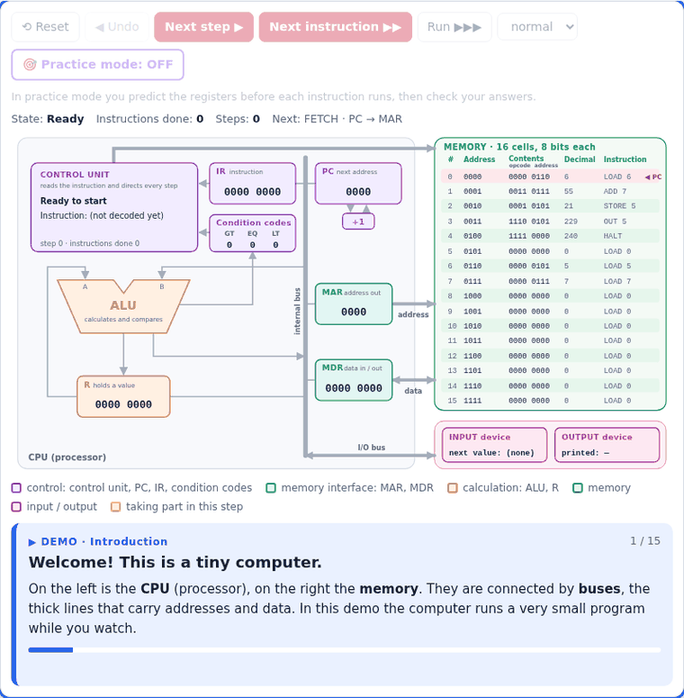

# Von Neumann Machine Simulator (CENG 111)

A browser-based simulator for the Von Neumann architecture, as taught in CENG 111. Students write a program in the
course's assembly language, load it into memory, and step through the **fetch → decode → execute** cycle. At each
step they see which components take part (PC, IR, MAR, MDR, R, ALU, condition codes, control unit, memory, I/O),
what goes into and comes out of each one, and which buses carry which values.

It is a **static website** (HTML, CSS and plain JavaScript, with no build step, no server code and no external
libraries), so it can be hosted for free and any number of students can use it at the same time.

## The machine

It follows the course textbook, Schneider & Gersting, *Invitation to Computer Science*.

| | |
|---|---|
| Memory | 16 cells, 8 bits each, with addresses 0–15 (4 bits). Instructions and data share the memory. |
| Instruction format | `oooo aaaa`: a 4-bit op code and a 4-bit address field X |
| Registers | PC, IR, MAR, MDR, R; condition codes GT, EQ, LT |
| Numbers | unsigned 8-bit binary numbers, 0 … 255 (a result that does not fit keeps only its last 8 bits: overflow) |

| Op code | Instruction | Meaning | Execute steps |
|---|---|---|---|
| 0000 | `LOAD X` | content of X → R | IR(address) → MAR; content of cell MAR → MDR; MDR → R |
| 0001 | `STORE X` | R → content of X | IR(address) → MAR; R → MDR; MDR → content of cell MAR |
| 0010 | `CLEAR X` | 0 → content of X | IR(address) → MAR; 0 → MDR; MDR → content of cell MAR |
| 0011 | `ADD X` | R + content of X → R | IR(address) → MAR; content of cell MAR → MDR; R + MDR → R |
| 0100 | `INCREMENT X` | content of X + 1 → content of X | IR(address) → MAR; content of cell MAR → MDR; MDR + 1 → MDR; MDR → content of cell MAR |
| 0101 | `SUBTRACT X` | R − content of X → R | IR(address) → MAR; content of cell MAR → MDR; R − MDR → R |
| 0110 | `DECREMENT X` | content of X − 1 → content of X | IR(address) → MAR; content of cell MAR → MDR; MDR − 1 → MDR; MDR → content of cell MAR |
| 0111 | `COMPARE X` | sets GT/EQ/LT from content of X vs R | IR(address) → MAR; content of cell MAR → MDR; compare MDR with R |
| 1000 | `JUMP X` | X → PC | IR(address) → PC |
| 1001 | `JUMPGT X` | if GT = 1 then X → PC | if GT = 1 then IR(address) → PC |
| 1010 | `JUMPEQ X` | if EQ = 1 then X → PC | if EQ = 1 then IR(address) → PC |
| 1011 | `JUMPLT X` | if LT = 1 then X → PC | if LT = 1 then IR(address) → PC |
| 1100 | `JUMPNEQ X` | if EQ = 0 then X → PC | if EQ = 0 then IR(address) → PC |
| 1101 | `IN X` | input → content of X | IR(address) → MAR; input → MDR; MDR → content of cell MAR |
| 1110 | `OUT X` | content of X → output | IR(address) → MAR; content of cell MAR → MDR; MDR → output |
| 1111 | `HALT` | stop | stop |

**Fetch** (the same for every instruction): `PC → MAR`, `content of cell MAR → MDR`, `MDR → IR`, `PC + 1 → PC`.
After fetch comes **decode**: the instruction decoder reads the op code.

**Assembly language** (the textbook's syntax):

```
.BEGIN
AGAIN:  LOAD    ZERO      -- LABEL:  INSTRUCTION  X   -- comment
        COMPARE N
        JUMPLT  AGAIN
        HALT
ZERO:   .DATA   0
N:      .DATA   -3
.END
```

The whole instruction set is defined in `js/core.js`: `INSTRUCTIONS` (op codes and meanings), `EXEC_PLANS`
(the execute steps of each instruction) and `MICRO_OPS` (what each step does and how it is explained).

## Features



- **Guided demos:** on the first visit, students choose one of two short demos on the real diagram and move through
  them at their own pace with **Next ▶** / **◀ Previous** (or the arrow keys), with an explanation at every step: `a = b + c` (the first instruction step by step, then one instruction at a time) or
  a **loop** that adds 1 + 2 + … + 5 (the first iteration instruction by instruction, then one iteration at a time,
  then the exit from the loop). The **▶ Watch demo** button brings the choice back. `docs/demo.gif` is a recording of it, for announcements.
- **Datapath diagram:** every part shows its full name and what it does (e.g. *MAR, memory address register*); the active components light up, the buses carrying data are animated, and each bus shows
  its value. The control bus shows the FETCH or STORE signal.
- **An explanation of every step** in plain language, with the register-transfer notation and a table of what
  each part gets (input) and gives (output).
- **Stepping controls:** Next step, Next instruction, Run (four speeds), Undo and Reset.
- **Automatic loading:** the program is put into memory as soon as it is typed or an example is chosen.
- **Colour-coded parts** (control, memory interface, calculation, memory, I/O), explanations coloured by phase, and a light/dark switch.
- **Memory editor:** 16 rows of 8 bits (written `0000 1001`), with the decimal value and the meaning as an instruction.
- **Practice mode:** before each instruction, students predict PC, IR, MAR, MDR, R and the condition codes, then
  check their answers, see the correct ones, and see the steps that happened.
- **Execution trace:** one row per step or per instruction, exportable to CSV (useful for answer keys).
- **Numbers in binary or decimal**, a choice made at the top of the page.
- **Eight example programs**, including a loop (1 + 2 + … + 5), the slides' `a = b + c`, `A = B + C − 7` and "sum of numbers"
  programs (the sum stops at 0, because the machine has no negative numbers).
- Works offline: open `index.html` directly from disk.

## Files

```
index.html            page layout and datapath diagram (SVG)
css/style.css
js/core.js            instruction set, machine, assembler (no DOM; unit-tested)
js/examples.js        example programs (their outputs are checked by the tests)
js/ui.js              rendering and interaction
tests/core.test.js
.github/workflows/pages.yml   runs the tests and deploys to GitHub Pages
```

## Run locally

Open `index.html` in a browser. To serve it instead: `python3 -m http.server 8000`, then open http://localhost:8000.

Tests (Node ≥ 20, no dependencies): `node --test tests/*.test.js`

## Hosting

**After changing a CSS or JS file**, raise the version number in `index.html` (`style.css?v=3`, `ui.js?v=3`, … → `?v=4`),
so that browsers load the new files instead of mixing them with old cached ones.


The workflow in `.github/workflows/pages.yml` runs the tests and publishes the site to GitHub Pages on every push
to `main`. One-time setup: **Settings → Pages → Source: GitHub Actions**.
